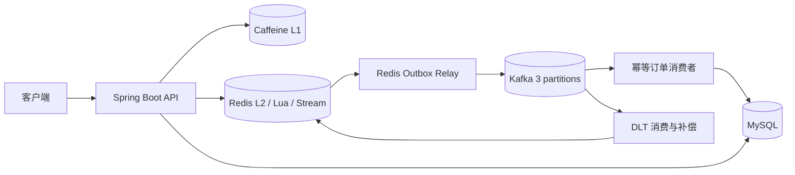
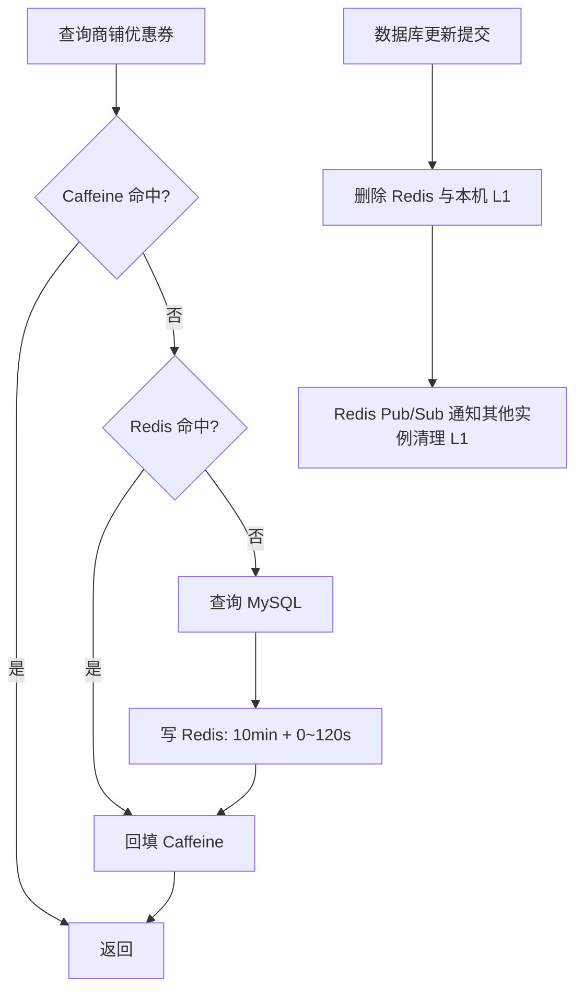
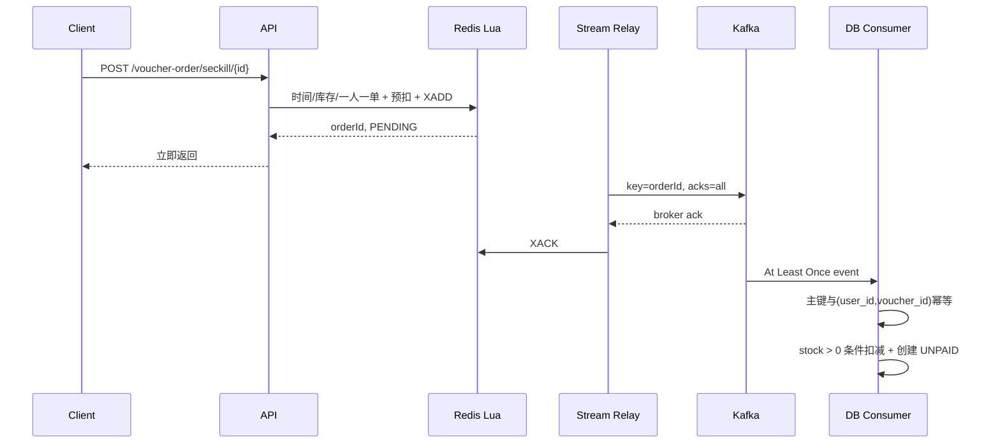

# CityHub Backend

CityHub 是一个面向求职作品集的本地生活后端项目。项目源自黑马点评课程的业务场景，但代码已在独立仓库中使用 Java 17、Spring Boot 3.5 和 Kafka 重新设计；课程原始文件不在本仓库中。

> 当前版本的重点是可靠性设计和可验证的高并发链路，不包含 AI 客服、真实支付渠道或评论系统。`/voucher-order/{id}/pay` 是明确标注的模拟支付接口。

## 三条技术主线

| 高并发缓存 | 秒杀系统 | 工程治理 |
| --- | --- | --- |
| Caffeine + Redis | Redis + Lua | Redis ZSet 滑动窗口限流 |
| 空值缓存、逻辑过期、TTL 抖动 | Redis Stream Outbox → Kafka | 统一响应、异常码、traceId |
| 事务后失效 + Pub/Sub 广播 | 幂等消费、重试、DLT 补偿 | 订单状态机、Actuator、CI |

个人完成的主要重构：包名与工程迁移、Spring Security opaque token、Caffeine/Redis 多级缓存、Lua 秒杀资格校验、Redis Outbox/Kafka 可靠订单链路、DLT 补偿、限流、订单状态机、Flyway、Testcontainers 测试与 JMeter 脚本。

## 架构



### 多级缓存流程



商铺详情还使用 Redis 空值缓存防穿透；热点数据保存逻辑过期时间，过期时返回旧值并由单个后台线程重建。缓存重建锁在同一后台线程内获取和释放。

### 秒杀与 Kafka 可靠链路



Lua 无法直接发送 Kafka，因此 Redis Stream 只承担可靠 Outbox，而不是最终业务队列。Relay 在 Kafka Broker 确认后才 `XACK`，并用 pending list/`XAUTOCLAIM` 恢复未确认消息。Kafka 消费语义明确为 **At Least Once**；数据库唯一索引是最终幂等屏障。临时异常指数退避重试 3 次，耗尽后进入 `cityhub.voucher-order.created.v1.dlt`。DLT 在确认数据库无订单后才执行 Redis 库存及购买标记补偿。

## 订单状态机

```text
UNPAID ──支付──> PAID ──核销──> USED
   │                └──退款──> REFUNDING ──> REFUNDED
   └──超时关单──> CANCELED
```

当前 v1 已实现 `UNPAID → PAID` 和 `UNPAID → CANCELED`。支付与关单均使用带旧状态条件的 SQL 更新，只有一个并发操作能成功。每分钟由 Redisson 分布式锁保护的任务分批关闭超过 15 分钟的订单；数据库库存与事务 Outbox 同事务提交，后台任务再可靠补偿 Redis。

## 快速启动

要求：JDK 17、Docker Desktop。

```bash
cp .env.example .env
docker compose up -d
./mvnw spring-boot:run
```

- API 前缀：`http://localhost:8081/api/v1`
- Swagger UI：`http://localhost:8081/api/v1/swagger-ui.html`
- Health：`http://localhost:8081/api/v1/actuator/health`
- Prometheus：`http://localhost:8081/api/v1/actuator/prometheus`

开发环境验证码通过日志输出，验证码只能使用一次。生产部署必须替换为短信服务，并关闭验证码日志。所有数据库、Redis、Kafka 和上传目录配置均可通过 `.env.example` 中的环境变量覆盖；`.env` 已被 Git 忽略。

常用接口：

| 方法与路径 | 说明 |
| --- | --- |
| `POST /api/v1/user/code` | 获取开发验证码，IP+手机号限流 |
| `POST /api/v1/user/login` | 登录并获取 Redis opaque token |
| `GET /api/v1/voucher/list/{shopId}` | 多级缓存优惠券列表 |
| `POST /api/v1/voucher-order/seckill/{id}` | Lua 校验后返回异步订单 ID |
| `GET /api/v1/voucher-order/{id}` | 查询本人订单或 PENDING/FAILED 状态 |
| `GET /api/v1/voucher-order/of/me` | 分页查询本人订单 |
| `POST /api/v1/voucher-order/{id}/pay` | 模拟支付 |
| `DELETE /api/v1/upload/blog?fileName=...` | ADMIN 安全删除上传文件 |

## 测试与压测

```bash
./mvnw verify
```

单元测试覆盖缓存穿透、Kafka 消费落库幂等、条件库存扣减、支付/关单并发屏障与事务 Outbox。Redis Lua 集成测试使用 Testcontainers 验证活动时间、库存、一人一单及滑动窗口；Docker 不可用时会明确跳过，CI 中会实际执行。

JMeter 脚本位于 `benchmark/`：

```bash
# 分别用 CACHE_MODE=database、redis、multilevel 重启应用后执行同口径测试
jmeter -n -t benchmark/cache-comparison.jmx \
  -Jthreads=100 -Jduration=120 -JshopId=1 \
  -l benchmark/results/cache.jtl

# users.csv 每行是一个已登录用户的 token,voucherId
jmeter -n -t benchmark/seckill.jmx \
  -Jthreads=200 -Jduration=60 -JusersFile=benchmark/data/users.csv \
  -l benchmark/results/seckill.jtl
```

结果模板见 [benchmark/README.md](benchmark/README.md)。仓库不预填或编造 QPS；每次报告必须记录机器配置、数据量、线程数、预热和持续时间，并从真实 `.jtl` 统计吞吐量、平均延迟、P95、P99 和错误率。

## Kafka 事件契约

```json
{
  "eventId": "uuid",
  "eventVersion": 1,
  "orderId": 123,
  "userId": 7,
  "voucherId": 1,
  "createdAt": "2026-09-16T07:00:00Z"
}
```

- 主 Topic：`cityhub.voucher-order.created.v1`（3 分区，key 为 `orderId`）
- 死信 Topic：`cityhub.voucher-order.created.v1.dlt`
- producer：`acks=all`、幂等、可重试
- consumer：手动按 record 提交，At Least Once

## 简历可用的五个亮点

1. 基于 Redis + Lua 原子完成秒杀时间、库存和一人一单校验，接口只返回异步订单 ID。
2. 使用 Caffeine + Redis 构建多级缓存，治理穿透、热点 Key、逻辑过期和跨实例一致性。
3. 设计 Redis Stream Outbox → Kafka 可靠订单链路，实现幂等消费、指数退避、DLT 与有条件补偿。
4. 基于 Redis TIME + ZSet Lua 实现 GLOBAL/IP/USER/业务参数滑动窗口限流。
5. 使用条件更新实现订单状态机及支付/关单并发控制，并用事务 Outbox 可靠恢复库存。

## 边界说明

- 本项目用于学习和求职展示，业务数据均为演示数据。
- 模拟支付不代表接入支付宝或微信支付；退款与核销仅保留状态定义，未在 v1 暴露业务接口。
- 真实压测结果应随测试环境单独记录，不把课程宣传数据当作本项目结果。
